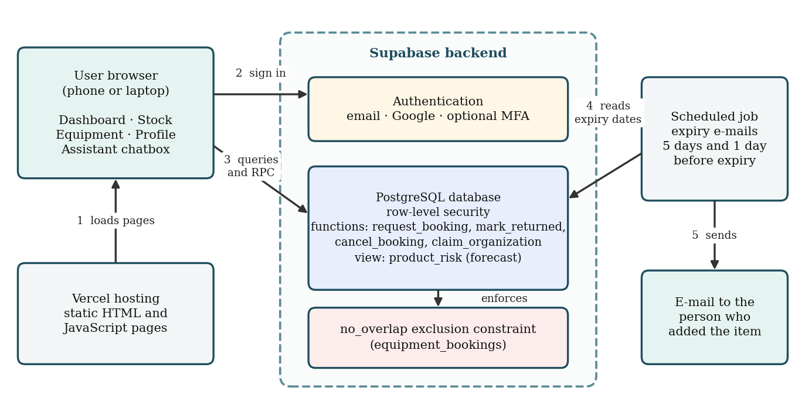

# Lab Tracker

A free, browser-based inventory and equipment booking system for college laboratories. Lab Tracker helps lab staff and students keep track of chemicals, consumables and instruments, get warned before items run out or expire, and book shared instruments without double bookings.

**Live app:** https://lab-tracker.vercel.app

> Built by Hemanth Kumar Pinnu, B.Tech Computer Science and Engineering (Core), Vellore Institute of Technology, Andhra Pradesh (VIT-AP University), Amaravati, India.

## Why Lab Tracker

Teaching laboratories often use paper registers or spreadsheets. This leads to unnoticed stock-outs, expired chemicals and clashes when several batches want the same instrument. Lab Tracker puts stock tracking, usage-based forecasting and conflict-free booking in one tool that works in a phone browser and needs no server of your own.

## Features

**Inventory**
- Add chemicals, instruments and consumables with lab, code, name, description, quantity, unit, reorder level and expiry date
- Enter the code by typing, scanning a QR code with the camera, or choosing a photo of the code
- One-tap **Used 1** logging, with a 10-minute **Undo**
- Edit or delete only the products you added

**Warnings and forecasting**
- Stock-out forecast from the last 14 days of logged use
- **Critical**: out of stock, at or below the reorder level, or 7 days or less of stock left
- **Watch**: 21 days or less of stock left, or the item will expire before it is used up
- "Usage not logged lately" when an item has no records for 14 days
- Expiry warning when adding an item that expires within 7 days, and e-mail reminders 5 days and 1 day before expiry

**Equipment booking**
- Daily schedule for each instrument; tap an empty slot to book it
- Overlapping bookings are rejected by the database itself (an exclusion constraint), so two people cannot book the same slot at the same moment
- Maintenance blocks, returns, cancellations and overdue flags
- Log of every booking attempt (booked, conflict, maintenance)
- Teachers can add equipment and export booking data as CSV (no names or e-mail addresses)

**Accounts and security**
- E-mail and password or Google sign-in, optional two-step verification (authenticator app)
- Organization is derived from the confirmed e-mail domain; free providers such as gmail.com stay personal accounts
- Two roles: **Lab Assistant** (own products) and **Lab Teacher** (verified by a platform administrator; sees products and equipment from their own organization)
- Row-level security and database functions enforce these rules on the server, not only in the browser

**Other**
- Mobile-first layout with bottom navigation
- Built-in assistant chatbox and a feedback form

## Screenshots

<!-- Add screenshots to a docs/screenshots folder, then replace these lines:

-->

## Architecture

## Tech stack

- Front end: HTML, CSS and JavaScript (no build step)
- Back end: [Supabase](https://supabase.com) (authentication, PostgreSQL with row-level security, database functions)
- Hosting: [Vercel](https://vercel.com)

## Run it yourself

1. **Create a Supabase project** at https://supabase.com.
2. **Create the database.** In the Supabase SQL Editor, run the files in the `supabase/` folder in numeric order: `001_core_tables.sql`, `002_helper_functions.sql`, `003_data_tables.sql`, `004_functions_and_triggers.sql`, `005_views.sql`, `006_row_level_security.sql` and `007_storage.sql`. The first file enables the `btree_gist` extension, which the booking constraint needs. To use the teacher-approval screens, add your own user id to the `platform_admins` table.
3. **Add your keys.** Open `supabaseClient.js` and set your own project URL and **anon** key (Project Settings → API). Never put a `service_role` key in the front-end code or in this repository.
4. **Run locally** with any static server, for example `npx serve .`, or **deploy** the folder to Vercel.
5. **Try it with sample data** by running `supabase/sample_data.sql` after you create an account (edit the e-mail address in the file first).
6. **Expiry e-mails** are sent by a scheduled job that is separate from the database files. [Describe here where it lives in this repository, for example an `api/` folder or a Supabase Edge Function, and which keys it needs.]

## How the main rules work

| Rule | Where it is enforced |
|---|---|
| No overlapping active bookings for the same equipment | `no_overlap` exclusion constraint on `equipment_bookings` |
| Booking, cancel and return checks | Database functions `request_booking`, `cancel_booking`, `mark_returned` |
| Who can see which products and equipment | Row-level security policies |
| Critical / Watch labels | Database view `product_risk` |
| Overdue returns | Database view `overdue_returns` |

## Testing

The main workflows were tested with two accounts (one Assistant, one Teacher) on sample data: adding products, QR entry, usage log and undo, forecast labels, expiry warning, overlapping booking, maintenance block, return and overdue, CSV export, data separation between organizations, and phone layout. A user study in a real laboratory is planned.

## Research paper

A paper describing the design and evaluation is available here: _link to be added after publishing (for example a Zenodo DOI)_.

## Contributing

Suggestions and bug reports are welcome. Open an issue, or use the feedback form inside the app.

## License

Released under the [MIT License](LICENSE).

## Contact

Hemanth Kumar Pinnu, hemanthkumarpinnu@gmail.com
